

# 🛡️ DroidSentinel

**A no-root Android security framework for live device analysis, network capture, and threat intelligence — in one dashboard.**

---

## Why DroidSentinel

Most mobile security tooling assumes you can root the device, jailbreak the capture pipeline, or install something invasive just to see what's happening. DroidSentinel doesn't.

Point it at a device over `adb`, and it gives you a real-time picture of what's installed, what's running, what's listening, and what's actually talking to the outside world — including a genuine `.pcap` you can open straight in Wireshark, captured with zero root.

Built for pentesters, malware analysts, and anyone teaching or learning mobile security who's tired of juggling six different tools to answer one question: **what is this app actually doing on this device?**

---

## ✨ Features

- **📦 App Enumeration** — every installed package, label, and MD5 hash, in seconds
- **⚙️ Process & 🌐 Port Enumeration** — live process tree and open TCP/UDP listeners, mapped to owning apps
- **🔍 Vulnerability Scanning** — 11 on-device checks plus live CVE lookups
- **🔐 Permissions Audit** — every dangerous permission, per app, flagged
- **🦈 No-Root Packet Capture** — a real `.pcap` file via a companion `VpnService` helper (DSCapture) — no root, no proxy cert hassle, opens natively in Wireshark
- **📡 Live Connection Monitor & Beacon Detection** — watch outbound connections in real time and catch periodic beaconing patterns
- **🤖 AI-Assisted Analysis** — opt-in, bring-your-own-key (Groq / OpenRouter) — ask plain-English questions about what was found
- **🧠 Threat Intelligence** — VirusTotal, AbuseIPDB, and GreyNoise lookups built in
- **📸 Snapshots & Baselines** — diff a device against a clean baseline to spot what changed
- **🔑 Encrypted local key storage** — every API key is encrypted at rest, never sent anywhere but its own provider

---

## 🖥️ Screenshots

| | |
|---|---|
| **Dashboard Overview**   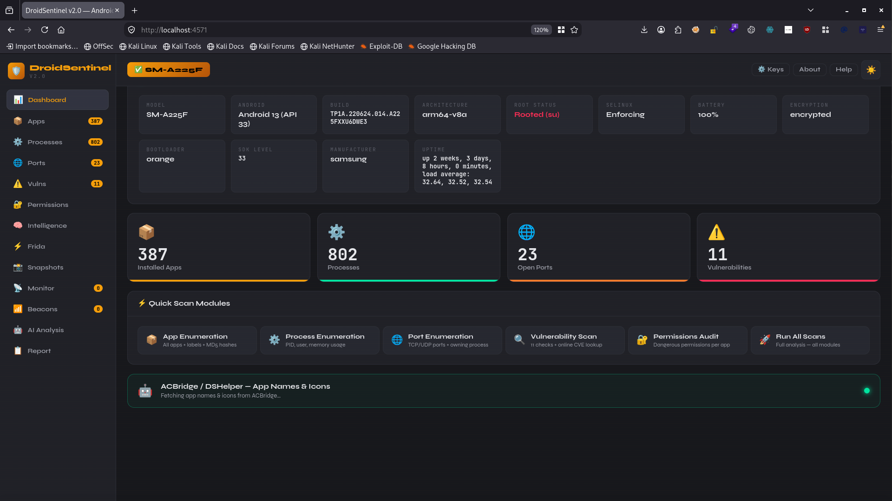 | **App Enumeration**   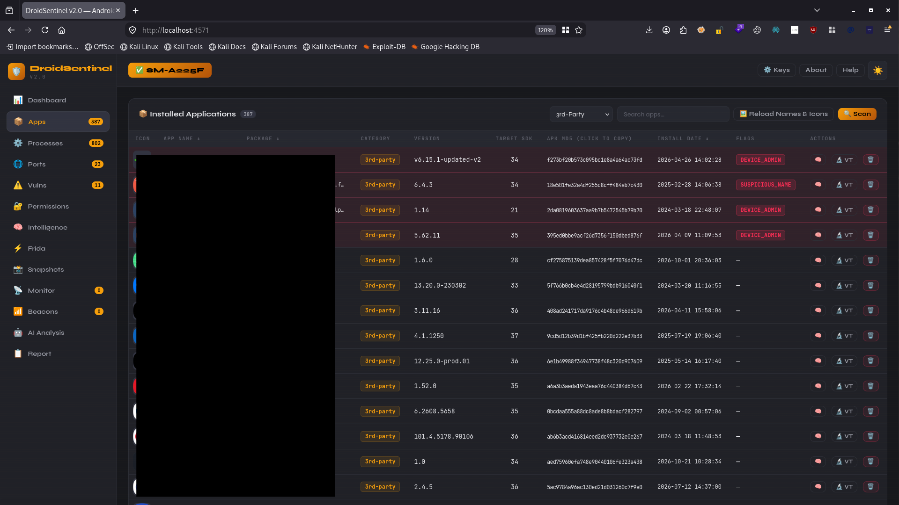 |
| **Process & Port Scan**   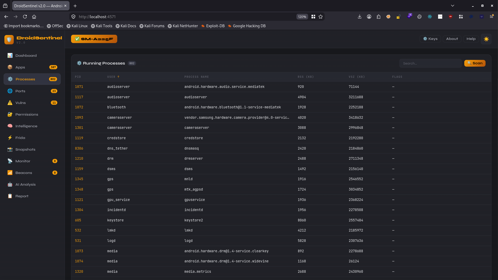 | **Port Scan**   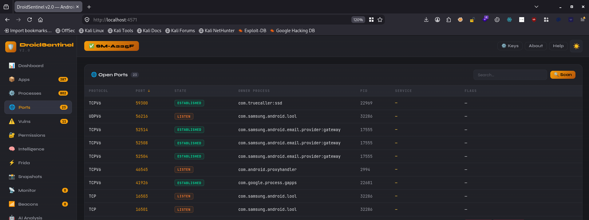 | 
| **Vulnerability Findings**   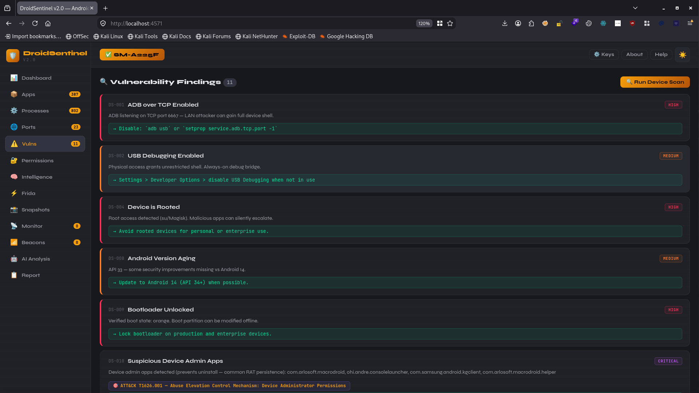 |
| **Permissions Audit**   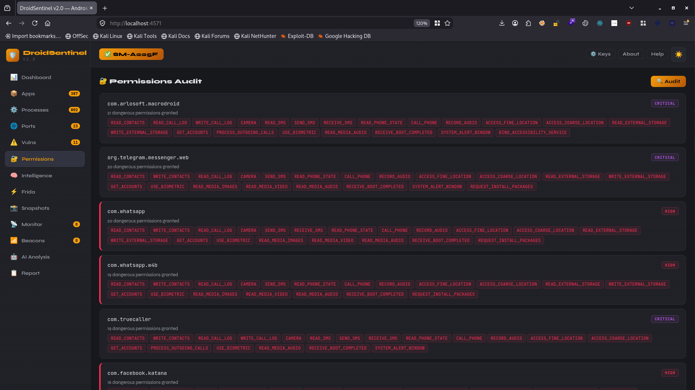 | **Packet Capture (DSCapture)**   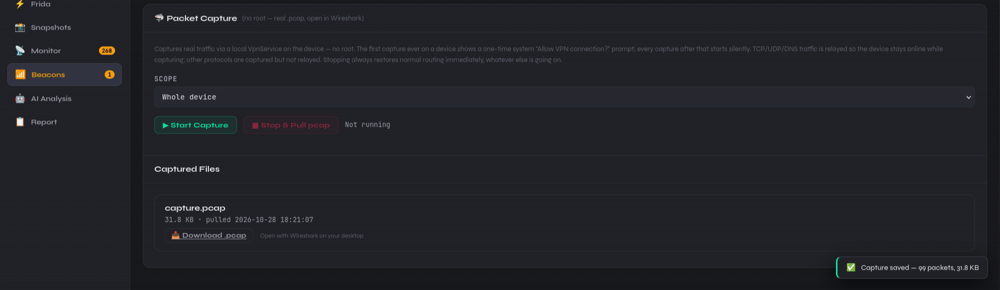 |
| **Live Connection Monitor**   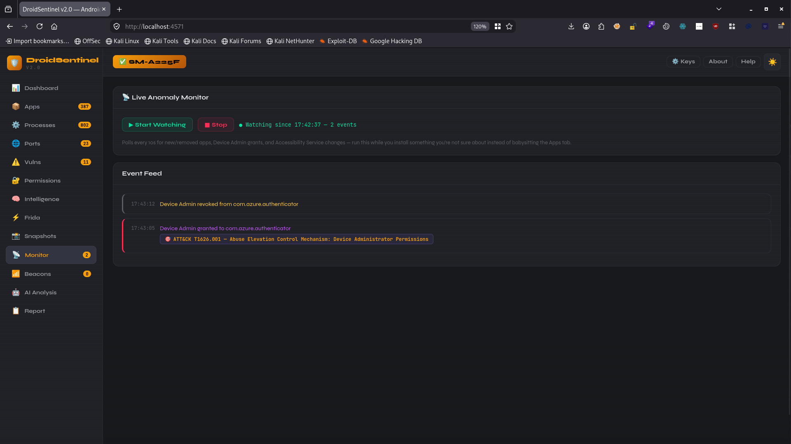 | **Beacon Detection**   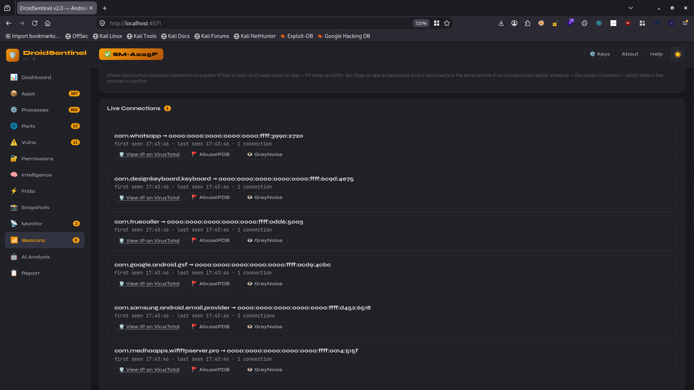 |
| **AI-Assisted Analysis**    | **About**   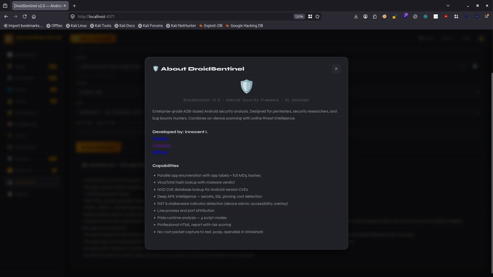 |
| **Reports**   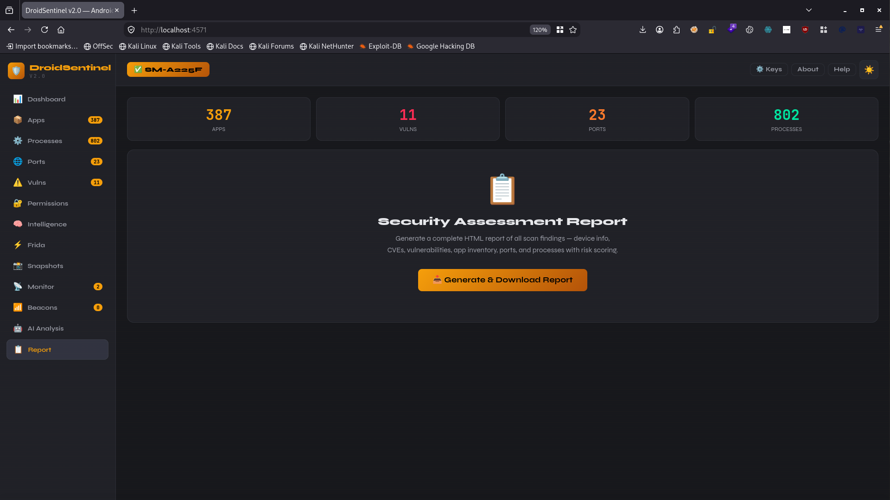 | 

---

## 🧩 How it works

DroidSentinel runs as a local Flask app that talks to a connected Android device over `adb` — no agent, no root, no device modification beyond a single companion helper APK (**DSCapture**) that uses Android's built-in `VpnService` to capture real traffic locally and hand back a standard pcap file. Everything stays on your machine; AI analysis is the one feature that leaves the device, and only when you explicitly trigger it with your own API key.

---

## 📦 Status

DroidSentinel is currently closed-source and in private beta. This repository hosts documentation, screenshots, and release notes — not the source itself.

Interested in early access or a demo? Reach out: **[ inocent.py@yahoo.com ]**

---

Built by <a href="https://x.com/1024Cyber">1024Cyber</a> — cybersecurity.

